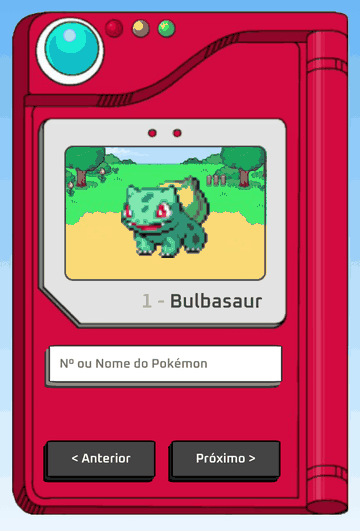

Pokédex web que mostra os Pokémon da 1ª à 5ª geração (estilo **Black/White**), com sprites animados. Busque pelo nome ou pelo número, ou navegue pelos botões **Anterior** e **Próximo**.

🔗 **Demo:** [evssousa.github.io/pokedex](https://evssousa.github.io/pokedex/)

<p align="center">
  
</p>

## Funcionalidades

- Busca por **nome** (`pikachu`) ou por **número** (`25`)
- Botões para ir ao Pokémon anterior e ao próximo
- Sprites animados da 5ª geração (Black/White)
- Mensagem de "Carregando..." durante a busca e de "Not found" quando o Pokémon não existe
- Layout que se adapta ao tamanho da tela

## Tecnologias

- **HTML5**: estrutura da página
- **CSS3**: posicionamento dos elementos sobre a imagem da Pokédex, `clamp()` para fontes responsivas
- **JavaScript (puro)**: `fetch` com `async/await` e manipulação do DOM
- **[PokéAPI](https://pokeapi.co/)**: dados e sprites dos Pokémon
- **[Google Fonts (Oxanium)](https://fonts.google.com/specimen/Oxanium)**: tipografia
- **GitHub Pages**: hospedagem

## Estrutura do projeto

```
pokedex/
├── assets/
│   ├── css/
│   │   └── style.css      # estilos e posicionamento
│   ├── favicons/          # ícone da aba do navegador
│   ├── images/
│   │   └── pokedex.png    # imagem da Pokédex
│   └── js/
│       └── script.js      # busca na API e navegação
├── img/
│   └── preview.gif        # animação usada neste README
├── index.html             # estrutura da página
└── README.md
```

## Como rodar localmente

Clone o repositório e abra o arquivo no navegador:

```bash
git clone https://github.com/evssousa/pokedex.git
cd pokedex
```

Depois, abra o `index.html` no navegador (duplo clique no arquivo ou, no VS Code, use a extensão Live Server).

> É preciso estar conectado à internet, porque os dados e as imagens dos Pokémon vêm da PokéAPI.

## Como funciona

1. `fetchPokemon()` faz uma requisição à PokéAPI (`/api/v2/pokemon/{nome ou número}`) e devolve os dados, ou nada se o Pokémon não existir.
2. `renderPokemon()` mostra "Carregando...", chama a busca e preenche o nome, o número e o sprite animado da geração 5 (`sprites.versions['generation-v']['black-white'].animated`). Se não houver resultado, esconde a imagem e mostra "Not found".
3. O formulário de busca e os botões **Anterior** e **Próximo** chamam `renderPokemon()`. O número do Pokémon atual fica guardado em uma variável (`searchPokemon`), e é com ele que os botões sabem para onde ir.

## Ideias de melhorias futuras

- Limitar o botão **Próximo** ao último Pokémon da 5ª geração (nº 649), já que os sprites animados de Black/White só existem até ele
- Tratar erros de rede (hoje, sem internet, a tela fica em "Carregando...")
- Mostrar tipos, altura e peso do Pokémon
- Permitir navegar com as setas do teclado
- Escolher entre sprite normal e `shiny`

## Créditos

- Dados e sprites: [PokéAPI](https://pokeapi.co/)
- Pokémon e seus personagens são marcas da Nintendo, Game Freak e The Pokémon Company. Este é um projeto de estudo, sem fins comerciais.

## Autor

Feito por **Everson Sousa**

[](https://github.com/evssousa)
[](https://linkedin.com/in/evssousa)
